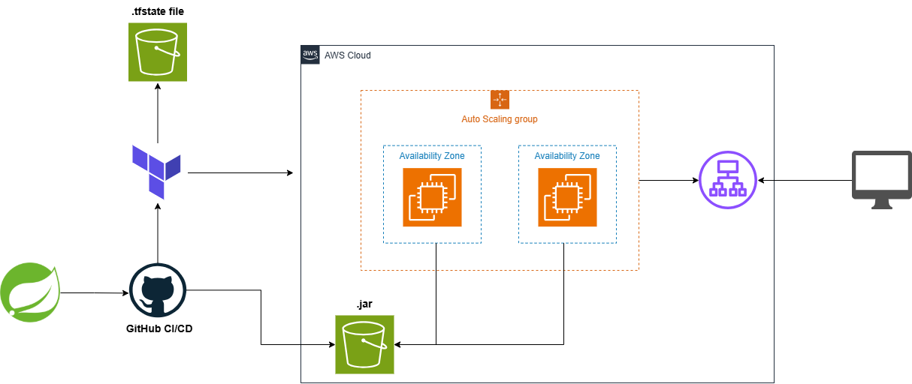

# auto-ec2-deploy

A Spring Boot application with an automated deployment pipeline: on every push, GitHub Actions provisions AWS infrastructure with Terraform, builds the app with Maven, and deploys it to an EC2 instance with ASG and ALB.





## Setting up AWS bootstrap

Generate public-private key for accessing EC2 instances through SSH
   ```
   ssh-keygen -t ed25519 -f ~/.ssh/<project_name>-key -C "<project_name>"
   ```


Policy for AWS IAM User using terraform to access S3 bucket for terraform state file
   ```
   {
    "Version": "2012-10-17",
    "Statement": [
           {
               "Sid": "TerraformStateBucketAccess",
               "Effect": "Allow",
               "Action": [
                   "s3:ListBucket",
                   "s3:GetBucketVersioning"
               ],
               "Resource": "arn:s3:bucket"
           },
           {
               "Sid": "TerraformStateObjectAccess",
               "Effect": "Allow",
               "Action": [
                   "s3:GetObject",
                   "s3:PutObject",
                   "s3:DeleteObject"
               ],
               "Resource": "arn:s3:bucket/*"
           }
       ]
   }
   ```

Policy for AWS IAM User using terraform to create terraform test resource ssm
   ```
   {
    "Version": "2012-10-17",
    "Statement": [
           {
               "Sid": "ssmAccess1",
               "Effect": "Allow",
               "Action": [
                   "ssm:PutParameter",
                   "ssm:GetParameter",
                   "ssm:ListTagsForResource",
                   "ssm:AddTagsToResource",
                   "ssm:RemoveTagsFromResource",
                   "ssm:DeleteParameter"
               ],
               "Resource": [
                   "arn:aws:ssm:eu-north-1:<ACCOUNT_ID>:parameter/auto-ec2-deploy-test/smoke-test"
               ]
           },
           {
               "Sid": "SsmAccess2",
               "Effect": "Allow",
               "Action": [
                   "ssm:DescribeParameters"
               ],
               "Resource": [
                   "arn:aws:ssm:eu-north-1:<ACCOUNT_ID>:*"
               ]
           }
       ]
   }
   ```

Policy for AWS IAM User using terraform to create ec2 infra

   ```
   {
    "Version": "2012-10-17",
    "Statement": [
           {
               "Sid": "CreateAutoScalingServiceLinkedRole",
               "Effect": "Allow",
               "Action": "iam:CreateServiceLinkedRole",
               "Resource": "arn:aws:iam::*:role/aws-service-role/autoscaling.amazonaws.com/AWSServiceRoleForAutoScaling",
               "Condition": {
                   "StringLike": {
                       "iam:AWSServiceName": "autoscaling.amazonaws.com"
                   }
               }
           },
           {
               "Sid": "ReadNetworkAndAMIInformation",
               "Effect": "Allow",
               "Action": [
                   "ec2:DescribeVpcs",
                   "ec2:DescribeVpcAttribute",
                   "ec2:DescribeSubnets",
                   "ec2:DescribeAvailabilityZones",
                   "ec2:DescribeImages",
                   "ssm:GetParameter",
                   "ssm:GetParameters",
                   "ec2:DescribeSecurityGroupRules",
                   "ec2:DescribeNetworkInterfaces"
               ],
               "Resource": "*"
           },
           {
               "Sid": "ManageSecurityGroups",
               "Effect": "Allow",
               "Action": [
                   "ec2:CreateSecurityGroup",
                   "ec2:DeleteSecurityGroup",
                   "ec2:DescribeSecurityGroups",
                   "ec2:AuthorizeSecurityGroupIngress",
                   "ec2:RevokeSecurityGroupIngress",
                   "ec2:AuthorizeSecurityGroupEgress",
                   "ec2:RevokeSecurityGroupEgress",
                   "ec2:CreateTags",
                   "ec2:DeleteTags"
               ],
               "Resource": "*"
           },
           {
               "Sid": "ManageLaunchTemplates",
               "Effect": "Allow",
               "Action": [
                   "ec2:CreateLaunchTemplate",
                   "ec2:DeleteLaunchTemplate",
                   "ec2:DescribeLaunchTemplates",
                   "ec2:DescribeLaunchTemplateVersions",
                   "ec2:RunInstances",
                   "ec2:ImportKeyPair",
                   "ec2:DeleteKeyPair",
                   "ec2:DescribeKeyPairs"
               ],
               "Resource": "*"
           },
           {
               "Sid": "ManageLoadBalancersAndTargetGroups",
               "Effect": "Allow",
               "Action": [
                   "elasticloadbalancing:CreateLoadBalancer",
                   "elasticloadbalancing:DeleteLoadBalancer",
                   "elasticloadbalancing:DescribeLoadBalancers",
                   "elasticloadbalancing:ModifyLoadBalancerAttributes",
                   "elasticloadbalancing:CreateTargetGroup",
                   "elasticloadbalancing:DeleteTargetGroup",
                   "elasticloadbalancing:DescribeTargetGroups",
                   "elasticloadbalancing:ModifyTargetGroup",
                   "elasticloadbalancing:ModifyTargetGroupAttributes",
                   "elasticloadbalancing:CreateListener",
                   "elasticloadbalancing:DeleteListener",
                   "elasticloadbalancing:DescribeListeners",
                   "elasticloadbalancing:ModifyListener",
                   "elasticloadbalancing:AddTags",
                   "elasticloadbalancing:RemoveTags",
                   "elasticloadbalancing:DescribeTags",
                   "elasticloadbalancing:DescribeLoadBalancerAttributes",
                   "elasticloadbalancing:DescribeTargetGroupAttributes",
                   "elasticloadbalancing:DescribeListenerAttributes",
                   "elasticloadbalancing:DescribeTargetHealth"
               ],
               "Resource": "*"
           },
           {
               "Sid": "ManageAutoScalingGroups",
               "Effect": "Allow",
               "Action": [
                   "autoscaling:CreateAutoScalingGroup",
                   "autoscaling:UpdateAutoScalingGroup",
                   "autoscaling:DeleteAutoScalingGroup",
                   "autoscaling:DescribeAutoScalingGroups",
                   "autoscaling:DescribeScalingActivities",
                   "autoscaling:DescribeTags",
                   "autoscaling:CreateOrUpdateTags",
                   "autoscaling:DeleteTags"
               ],
               "Resource": "*"
           },
           {
               "Sid": "PassEC2RoleToLaunchTemplate",
               "Effect": "Allow",
               "Action": "iam:PassRole",
               "Resource": "arn:aws:iam::*:role/*-ec2-role"
           }
       ]
   }
   ```


Policy for AWS IAM User using terraform to create s3 bucket for .jar

   ```
   {
    "Version": "2012-10-17",
    "Statement": [
           {
               "Sid": "GetAccountInformation",
               "Effect": "Allow",
               "Action": "sts:GetCallerIdentity",
               "Resource": "*"
           },
           {
               "Sid": "ManageArtifactBucket",
               "Effect": "Allow",
               "Action": [
                   "s3:CreateBucket",
                   "s3:DeleteBucket",
                   "s3:DeleteObject",
                   "s3:ListBucket",
                   "s3:GetBucketLocation",
                   "s3:GetBucketPolicy",
                   "s3:GetBucketPublicAccessBlock",
                   "s3:PutBucketPublicAccessBlock",
                   "s3:GetBucketAcl",
                   "s3:GetBucketCORS",
                   "s3:GetBucketWebsite",
                   "s3:GetBucketVersioning",
                   "s3:GetBucketRequestPayment",
                   "s3:GetBucketLogging",
                   "s3:GetLifecycleConfiguration",
                   "s3:GetReplicationConfiguration",
                   "s3:GetEncryptionConfiguration",
                   "s3:GetBucketObjectLockConfiguration",
                   "s3:GetBucketTagging",
                   "s3:ListBucketVersions",
                   "s3:DeleteObjectVersion"
               ],
               "Resource": "arn:aws:s3:::*-artifacts-*"
           },
           {
               "Sid": "ManageEC2IAMRoles",
               "Effect": "Allow",
               "Action": [
                   "iam:CreateRole",
                   "iam:DeleteRole",
                   "iam:GetRole",
                   "iam:UpdateAssumeRolePolicy",
                   "iam:AttachRolePolicy",
                   "iam:DetachRolePolicy",
                   "iam:ListAttachedRolePolicies",
                   "iam:PutRolePolicy",
                   "iam:DeleteRolePolicy",
                   "iam:GetRolePolicy",
                   "iam:ListRolePolicies",
                   "iam:ListInstanceProfilesForRole"
               ],
               "Resource": "arn:aws:iam::*:role/*-ec2-role"
           },
           {
               "Sid": "ManageEC2InstanceProfiles",
               "Effect": "Allow",
               "Action": [
                   "iam:CreateInstanceProfile",
                   "iam:DeleteInstanceProfile",
                   "iam:GetInstanceProfile",
                   "iam:AddRoleToInstanceProfile",
                   "iam:RemoveRoleFromInstanceProfile"
               ],
               "Resource": "arn:aws:iam::*:instance-profile/*-ec2-profile"
           },
           {
               "Sid": "ReadManagedPolicyInformation",
               "Effect": "Allow",
               "Action": [
                   "iam:GetPolicy",
                   "iam:GetPolicyVersion"
               ],
               "Resource": "arn:aws:iam::aws:policy/AmazonSSMManagedInstanceCore"
           }
       ]
   }
   ```

## Docker setup

Configure .env file using .env.example as example of needed properties.

Running docker
   ```
   docker compose -f ./docker-compose-aws.yml up
   docker exec -it terraform sh
   ```

Executing terraform in container    
   ```  
   terraform init \
       -backend-config="bucket=bucket_name" \
       -backend-config="key=bucket_key" \
       -backend-config="region=bucket_region"
   terraform plan -var="allowed_cidr=CIDR_IP" -auto-approve
   terraform apply -var="allowed_cidr=CIDR_IP" -auto-approve
   terraform destroy -var="allowed_cidr=CIDR_IP" -auto-approve
   ```

Deleting all AWS infrastructure
   ```  
   terraform destroy -var="allowed_cidr=CIDR_IP"
   ```


## CI/CD setup

The workflow `.github/workflows/deploy.yaml` runs on every push: Terraform plan/apply, then Maven build. EC2 deploy is a placeholder.


### Option 1. OIDC AWS

Define in github variable AWS_AUTH_METHOD = oidc

1. **OIDC provider** (IAM → Identity providers): URL `https://token.actions.githubusercontent.com`, audience `sts.amazonaws.com`.
2. **IAM role** with this trust policy (replace `<ACCOUNT_ID>`):
   ```json
   {
     "Version": "2012-10-17",
     "Statement": [{
       "Effect": "Allow",
       "Principal": {"Federated": "arn:aws:iam::<ACCOUNT_ID>:oidc-provider/token.actions.githubusercontent.com"},
       "Action": "sts:AssumeRoleWithWebIdentity",
       "Condition": {
         "StringEquals": {"token.actions.githubusercontent.com:aud": "sts.amazonaws.com"},
         "StringLike": {"token.actions.githubusercontent.com:sub": "repo:<REPO_NAME>/auto-ec2-deploy:ref:refs/heads/develop"}
       }
     }]
   }
   ```
3. **Role permissions**: SSM parameter access (`ssm:*Parameter*`, `ssm:AddTagsToResource`, `ssm:ListTagsForResource`) and read/write on the state bucket.
4. **S3 bucket** (created manually, once) to store the Terraform state.

### Option 2. Credentials


Define in GitHub variable AWS_AUTH_METHOD = credentials

Add IAM User access and secret key in GitHub secrets


### GitHub

Settings → Secrets and variables → Actions → **Variables**/**Secrets** → *Repository variables*:

| Variable                | Value                                                           |
|-------------------------|-----------------------------------------------------------------|
| `ENABLE_PIPELINE`       | `true` to enable the whole pipeline (anything else disables it) |
| `ENABLE_RUN_TERRAFORM`  | `true` to enable the Terraform job (off by default)             |
| `DEPLOY_TO_EC2`         | `true` to enable the deploy job (off by default)                |
| `ALLOWED_CIDR`         | Allowed IPs to access load balancer                             |
| `AWS_AUTH_METHOD`       | AWS Auth method, values = ('credentials' \| 'oidc')             |
| `AWS_ROLE_ARN`          | ARN of the IAM role above (AWS_AUTH_METHOD= oidc)               |
| `AWS_REGION`            | AWS Region for S3 terraform bucket                              |
| `AWS_ACCESS_KEY_ID`     | Access key for Github Actions (AWS_AUTH_METHOD= credentials)    |
| `AWS_SECRET_ACCESS_KEY` | ARN of the IAM role above (AWS_AUTH_METHOD= credentials)        |
| `TF_STATE_BUCKET`       | Name of the S3 state bucket                                     |


